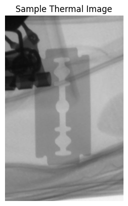

# Thermal Weapon Detection with ResNet50 and Grad-CAM

Deep learning classification of weapons in X-ray / thermal baggage images, with **Grad-CAM heatmaps** that show which regions of the image drove each prediction.

<p>
  
  
  
  
  
</p>

## 📖 Overview

This project builds a transfer-learning classifier on a frozen **ResNet50** (ImageNet weights) to recognise threat objects such as blades, shurikens and guns in X-ray baggage images. **Grad-CAM** is then applied to the last convolutional block so each prediction can be inspected visually, which is the explainable-AI part of the project.



## ✨ Key Features

- Transfer learning with **ResNet50** pre-trained on ImageNet
- Image augmentation: rotation, shifts, zoom and horizontal flip
- **Grad-CAM** heatmaps overlaid on the original image
- Batch prediction with confidence scores (green title at or above the threshold, red below)

## 🗂️ Dataset

| Item | Value |
|---|---|
| Type | X-ray baggage images |
| Training images | 1,560 (80% split) |
| Validation images | 390 (20% split) |
| Total | 1,950 images |
| Classes found by the loader | 3 |
| Image size | 224 × 224, pixel values scaled to 0–1 |

Class names used in the code: Blade, Shuriken, Gun, Others.


## 🧠 Model

| Component | Detail |
|---|---|
| Base model | ResNet50, ImageNet weights, frozen |
| Pooling | Global Average Pooling |
| Dense layers | 256 (ReLU), then 128 (ReLU) |
| Output | Softmax over the classes |
| Optimizer / loss | Adam / categorical cross-entropy |
| Batch size / epochs | 32 / 10 |

## 📊 Results

Training log from the final run:

| Epoch | Train accuracy | Val accuracy | Train loss | Val loss |
|---|---|---|---|---|
| 1 | 0.4428 | 0.4538 | 1.1068 | 0.9950 |
| 5 | 0.5679 | 0.4872 | 0.9046 | 0.9956 |
| 10 | 0.6477 | 0.5282 | 0.7932 | 0.9438 |


Training accuracy and loss improved steadily. Validation accuracy ended at about 53%, well below training accuracy, so this model is a **baseline** that needs further work (see below).

### Grad-CAM output

The top row shows the input images with the predicted class and confidence. The bottom row shows the Grad-CAM heatmaps, where warmer colours mark the regions that most influenced the prediction.


Sample predictions on test images: all five were classified as **Blade**, with confidence between 43% and 44%.


## ⚠️ Limitations and Next Steps

- The base network is frozen, so only the new dense layers were trained. Unfreezing the top ResNet50 blocks for **fine-tuning** should help.
- The dataset is small (1,950 images). More data or class balancing would improve generalisation.
- Prediction confidence is low (about 44%), so a larger number of epochs and tuning of the learning rate are worth trying.
- Report per-class precision, recall and a confusion matrix, not only overall accuracy.
- Set `classes` from `train_data.class_indices` so label names always match the model's output order.

## 🚀 How to Run

The code was developed in Google Colab.

1. Place the dataset at `/content/object_data/xray_baggages` (or change `data_dir` in the script).
2. Install the requirements:
   ```bash
   pip install -r requirements.txt
   ```
3. Run:
   ```bash
   python thermal_weapon_detection.py
   ```

The trained model is saved as `thermal_weapon_resnet50.h5`. It is not included in this repository because of its size.

## 📁 Repository Structure

```
Thermal-Weapon-Detection-GradCAM/
├── thermal_weapon_detection.py
├── requirements.txt
├── README.md
└── images/
```

## 👩‍💻 Author

**A.K. Ramya** · [LinkedIn](https://linkedin.com/in/ramya-anbu) · [Portfolio](https://ramyaanbazhagan.github.io/portfolio/)
